# 🌱 Spring Boot 포트폴리오 프로젝트

> **학번** 20231410 · **이름** 이호준

Spring Boot로 개인 포트폴리오 사이트를 만들고, 주차별로 DB 연동 → 로그인 → 권한 관리 → REST API → 게시판까지 기능을 하나씩 쌓아 올린 프로젝트입니다.

## 🛠 사용 기술

| 구분 | 내용 |
|---|---|
| Backend | Spring Boot, Spring Data JPA, Spring Security |
| Frontend | Thymeleaf, Bootstrap 5 (First Portfolio 템플릿) |
| Database | MySQL |
| Tool | VS Code, Postman |

## 📅 주차별 진행 내용

| 주차 | 주제 | 핵심 기능 |
|:---:|---|---|
| 2주차 | 프로젝트 시작 | 기본 화면, URL 매핑, 컨트롤러 |
| 3주차 | 포트폴리오 화면 | 프로필 수정, 기술/경험 세부 페이지 |
| 4주차 | DB 연동 | JPA + MySQL, 데이터 조회 화면 |
| 5주차 | 회원 · 로그인 | 회원가입, 로그인/로그아웃, BCrypt 암호화 |
| 6주차 | 권한 관리 | 관리자 페이지, 권한 변경, 접근 제어 |
| 7주차 | REST API | 회원 관리 API, 검색 API, 오류 처리 통합 |
| 9주차 | 게시판 | 글 CRUD, 조회수, 내가 쓴 글 |
| 10주차 | 게시판 고도화 | 페이징, 검색, 댓글, 회원 삭제 보호 |

---

## 2주차 · 프로젝트 시작

- **실습** : 스프링부트 프로젝트 준비 및 기본 화면 실행
- **추가실습** : URL 매핑 및 컨트롤러 추가

`/hello2` 주소로 들어오면 컨트롤러가 데이터를 넘겨주고, 화면에 인사말이 출력됩니다.

    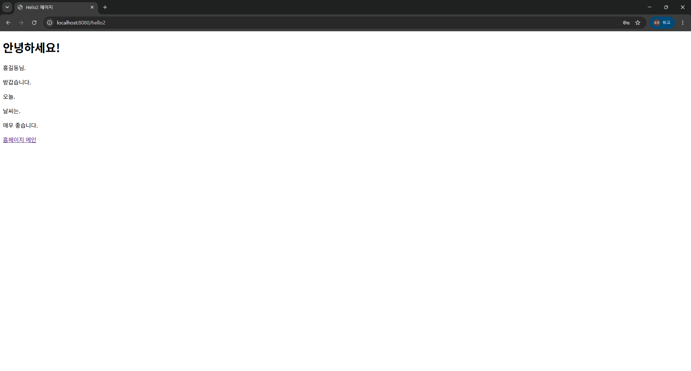
    
<em>컨트롤러에서 넘긴 데이터가 출력되는 /hello2 페이지</em>

 

## 3주차 · 포트폴리오 화면 꾸미기

- **실습** : 포트폴리오 템플릿 적용 및 프로필 수정
- **추가실습** : 기술/경험 항목별 세부 페이지 제작

웹 · 앱 · AI · 게임 4개 분야 카드를 만들고, 각각 눌렀을 때 이동하는 세부 페이지(`/detailed` ~ `/detailed4`)를 따로 만들었습니다.

    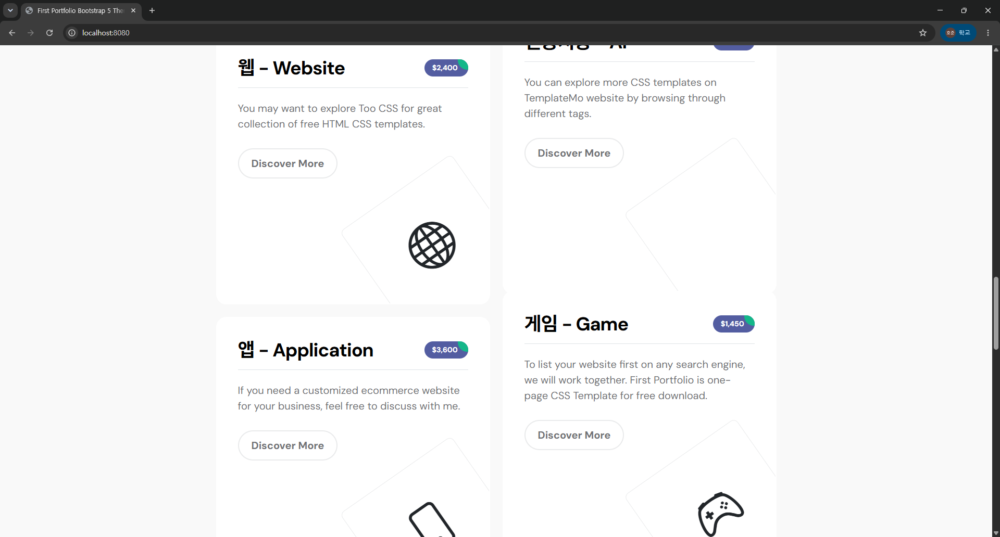
    
<em>메인 페이지의 기술/경험 카드</em>

 

    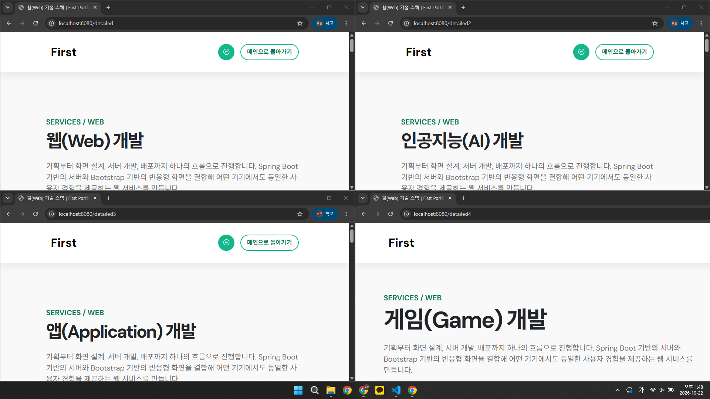
    
<em>웹 · AI · 앱 · 게임 개발 세부 페이지</em>

 

## 4주차 · 데이터베이스 연동

- **실습** : MySQL 연동 및 프로필 수정
- **추가실습** : 사용자 정보 수정 및 뷰 수정

JPA로 MySQL의 `testdb` 테이블과 연결하고, 저장된 데이터를 웹 화면 표로 보여 줍니다.

    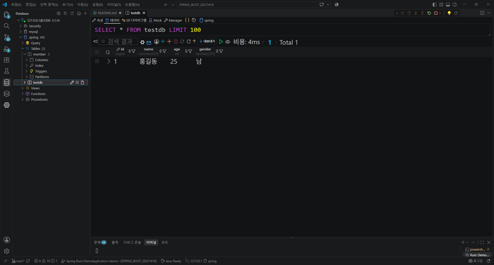
    
<em>MySQL testdb 테이블에 저장된 데이터</em>

 

    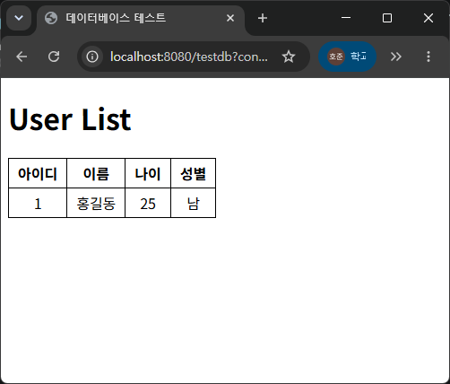
    
<em>DB 데이터를 화면에 출력한 User List</em>

 

## 5주차 · 회원가입과 로그인

- **실습** : Spring Security 로그인/로그아웃 구현, 비밀번호 BCrypt 암호화
- **추가실습** : 로그인 상태 유지(Remember-Me), 비밀번호 확인 검증

로그인하면 상단 메뉴에 아이디와 권한 배지가 표시되고, 회원가입 시 비밀번호와 비밀번호 확인이 다르면 가입을 막습니다.

    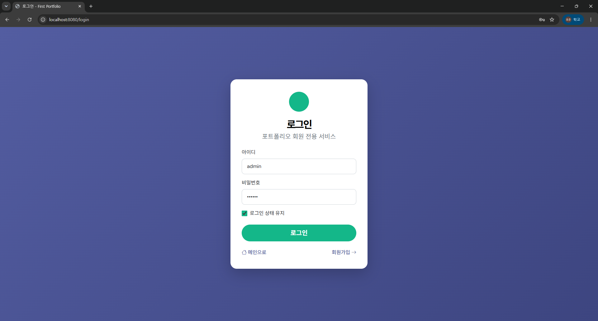
    
<em>로그인 화면 (로그인 상태 유지 체크박스 포함)</em>

 

    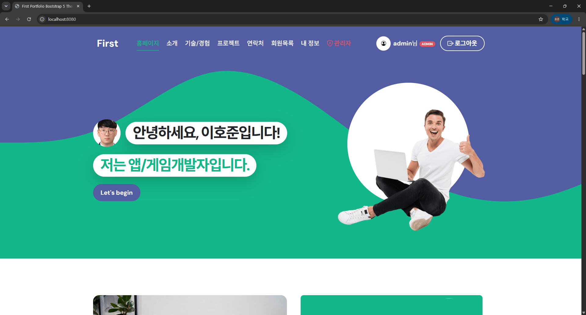
    
<em>로그인 후 메인 화면 — 아이디와 ADMIN 배지 표시</em>

 

    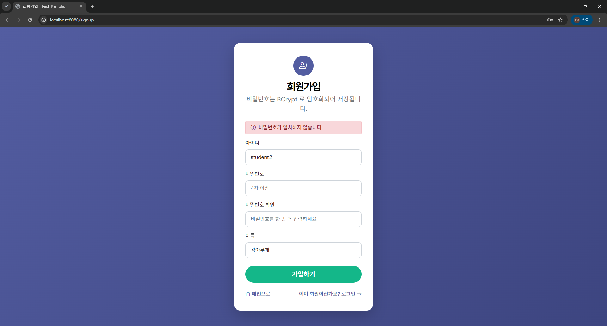
    
<em>비밀번호가 일치하지 않으면 오류 메시지 표시</em>

 

    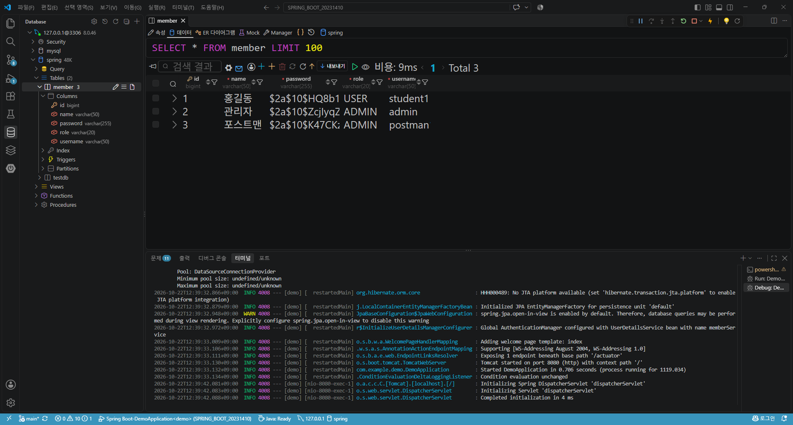
    
<em>검증에 실패한 회원은 DB에 저장되지 않고, 비밀번호는 BCrypt로 암호화되어 저장</em>

 

## 6주차 · 권한 관리

- **실습** : 권한별 접근 제어 및 관리자 페이지 분리
- **추가실습** : 관리자 자기 보호, MANAGER 권한 추가

관리자 페이지에서 회원 권한을 USER / MANAGER / ADMIN 으로 바꿀 수 있습니다. 관리자가 실수로 자기 자신의 권한을 바꾸거나 삭제하지 못하도록 막았고, 권한이 없는 페이지에 들어가면 403 화면을 보여 줍니다.

    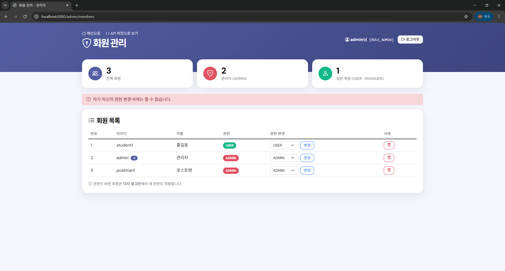
    
<em>자기 자신의 권한 변경·삭제 차단</em>

 

    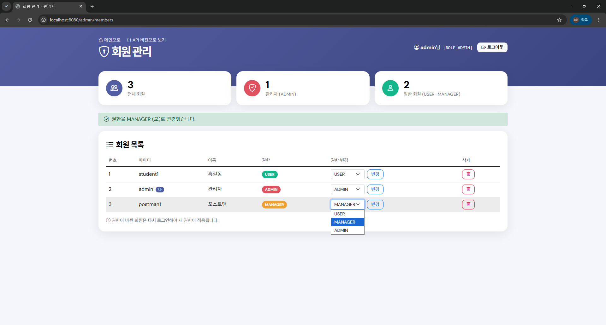
    
<em>MANAGER 권한 추가 및 권한 변경</em>

 

    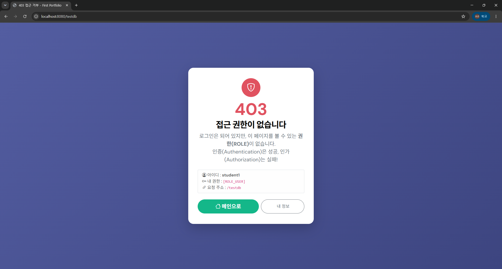
    
<em>USER 권한으로 /testdb 접근 시 403 접근 거부</em>

 

## 7주차 · REST API

- **실습** : 회원 관리 REST API 구현 및 Postman 테스트
- **추가실습** : 회원 검색 API (아이디 또는 이름에 검색어가 들어간 회원), 오류 처리 한곳에 모으기

화면 새로고침 없이 JSON으로 데이터를 주고받는 회원 관리(API 버전) 페이지를 만들었습니다. 오류는 한 곳에서 처리해 `{"error": "..."}` 형태로 일정하게 응답합니다.

    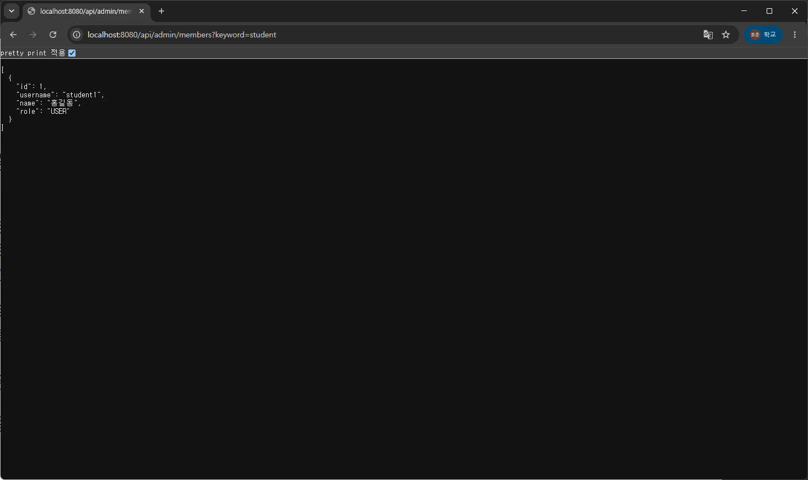
    
<em>GET /api/admin/members?keyword=student 검색 결과</em>

 

    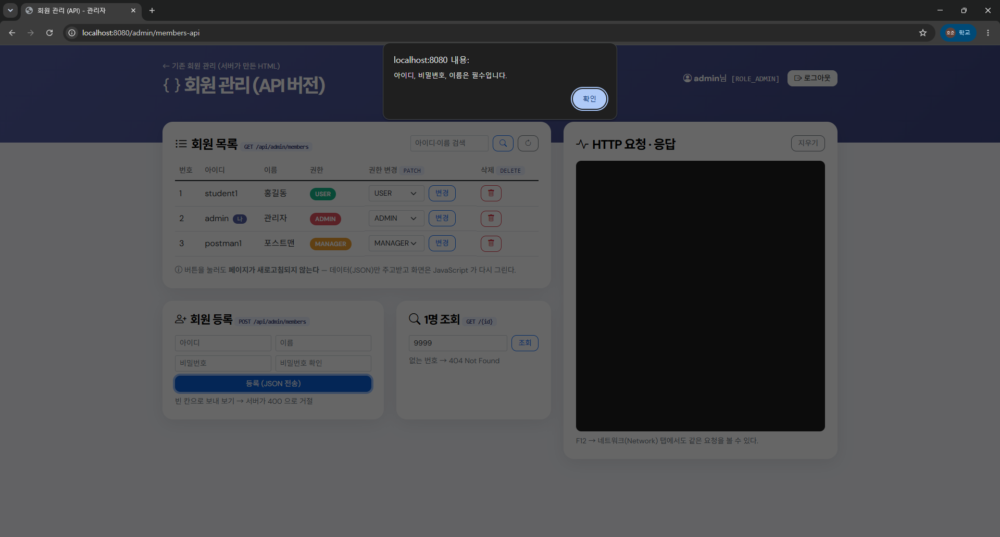
    
<em>빈 값으로 회원 등록 시 오류 메시지 알림</em>

 

    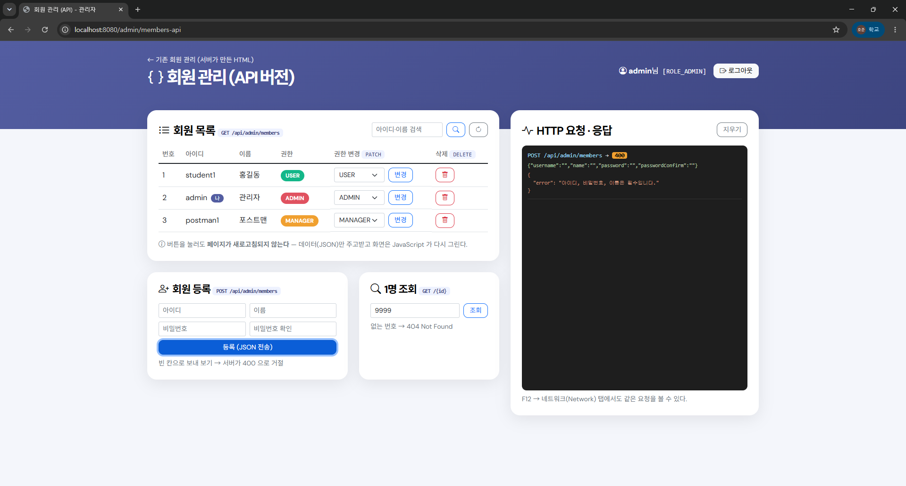
    
<em>서버가 400 상태 코드와 JSON 오류 메시지로 응답</em>

 

## 9주차 · 게시판 만들기

- **실습** : 게시판 화면 및 글 CRUD (작성 · 조회 · 수정 · 삭제)
- **추가실습** : 조회수 증가, 내가 쓴 글 모아 보기

글 상세 화면을 열 때마다 조회수가 1씩 오르고, `/board/my` 에서는 로그인한 사람이 쓴 글만 최신순으로 볼 수 있습니다.

    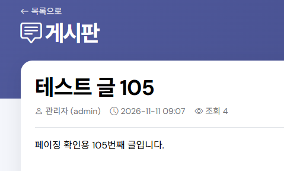
    
<em>상세 화면을 열 때마다 증가하는 조회수</em>

 

    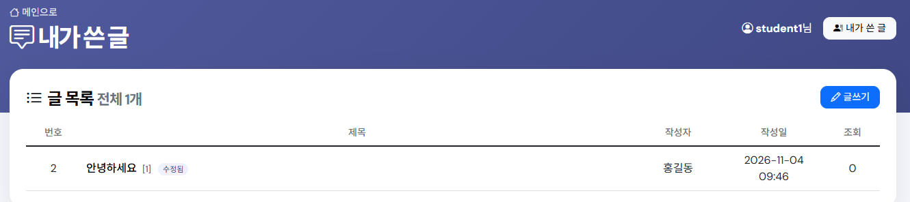
    
<em>내가 쓴 글 페이지 — 로그인한 회원(student1)의 글만 표시</em>

 

## 10주차 · 게시판 고도화

- **실습** : 페이징, 제목+내용 검색, 댓글 작성/삭제, 글이나 댓글이 있는 회원 삭제 방지
- **추가실습** : 작성자로 검색, 내가 쓴 글 페이징

글 목록을 10개씩 나눠 보여 주고, 검색 범위를 **제목+내용 / 작성자** 중에서 고를 수 있습니다. 글과 댓글은 서로 연결되어 있어서, 작성한 글이나 댓글이 남아 있는 회원은 삭제할 수 없도록 막았습니다.

    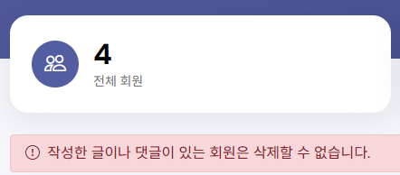
    
<em>글이나 댓글을 쓴 회원은 삭제 불가</em>

 

    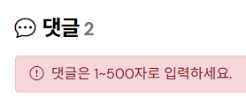
    
<em>빈 댓글이나 500자를 넘는 댓글은 등록 불가</em>

 

    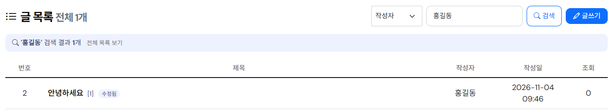
    
<em>검색 범위를 '작성자'로 선택해 홍길동의 글만 검색</em>

 

    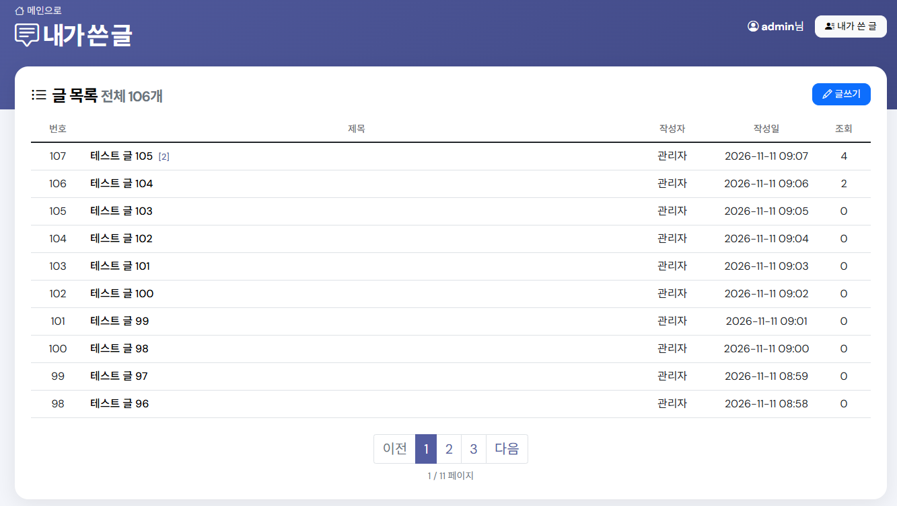
    
<em>내가 쓴 글 페이징 — 106개의 글을 10개씩 나눠서 표시</em>

 
